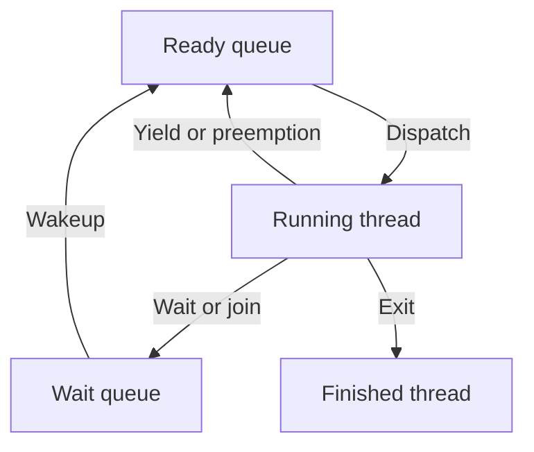

# Runtime design

The runtime multiplexes user threads on one OS thread. Each user thread has a
`ucontext_t`, a private 64 KiB stack, and a priority from 0 to 127. The scheduler
has its own saved context and dispatches the highest-priority runnable thread
from 128 FIFO ready queues.

[Runtime implementation](../ThreadSystemCode/ThreadLibrary/thread.c) ·
[Public API](../ThreadSystemCode/ThreadLibrary/threads.h)

## Thread lifecycle

`t_start` installs the timer handler, creates the initial thread, and enters the
scheduler. Thread creation uses `getcontext` and `makecontext` to configure
`thread_bootstrap` on the new stack. The bootstrap calls the thread function and
calls `t_exit(0)` when it returns. A successful `t_fork` hands control back to
the scheduler immediately when the newly created thread has higher priority.

The scheduler switches into a thread with `swapcontext`. On exit, the thread
marks itself finished, moves its joiners to the ready queues, and transfers
control to the scheduler with `setcontext`. The scheduler frees the finished
thread's stack once execution has moved off it. When no thread is ready and
some remain blocked, the scheduler reports a deadlock.

## Timer and scheduling

The default quantum is 10 ms. The periodic `ITIMER_VIRTUAL` timer counts process
user CPU time and delivers `SIGVTALRM`. If another thread is ready, the handler
places the running thread at the tail of its priority queue and returns control
to the scheduler. An explicit `t_yield` uses the same ready-queue placement.
This gives FIFO round-robin dispatch within a priority. If the only alternatives
have lower priority, the scheduler can select the yielding thread again.

Scheduler and synchronization paths mask `SIGVTALRM` while changing shared
queues. The runtime saves and restores the previous timer and signal handler
around `t_start`. Switching contexts from inside a signal handler is a
limitation of this educational implementation.

## Blocking and wakeup

| Operation | Blocking and wakeup behavior |
|---|---|
| Join | A caller waiting for a live thread blocks in that thread's join queue. Exit wakes all joiners. |
| Lock | A caller blocked on another thread's lock waits in a priority queue. Release hands ownership directly to the highest-priority waiter. |
| Condition | Wait releases the lock and queues the caller with the timer signal masked. Signal makes one highest-priority waiter ready. The waiter reacquires the lock before returning. |
| Semaphore | A wait consumes an available permit or blocks. A post wakes one highest-priority waiter directly or increments the count if no one is waiting. |

The [CTest smoke test](../tests/smoke_test.c) checks FIFO queue operations,
priority dispatch, joins, and basic coordination. Timer-driven preemption
requires separate coverage.
